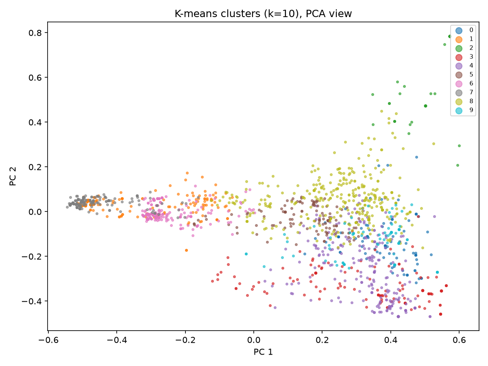
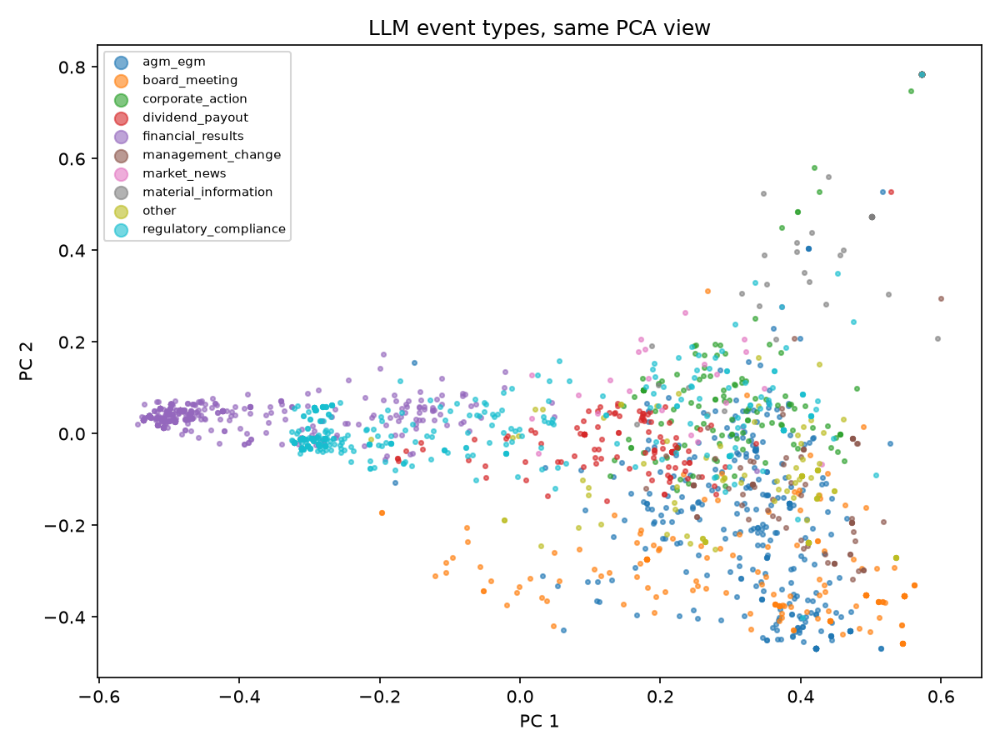
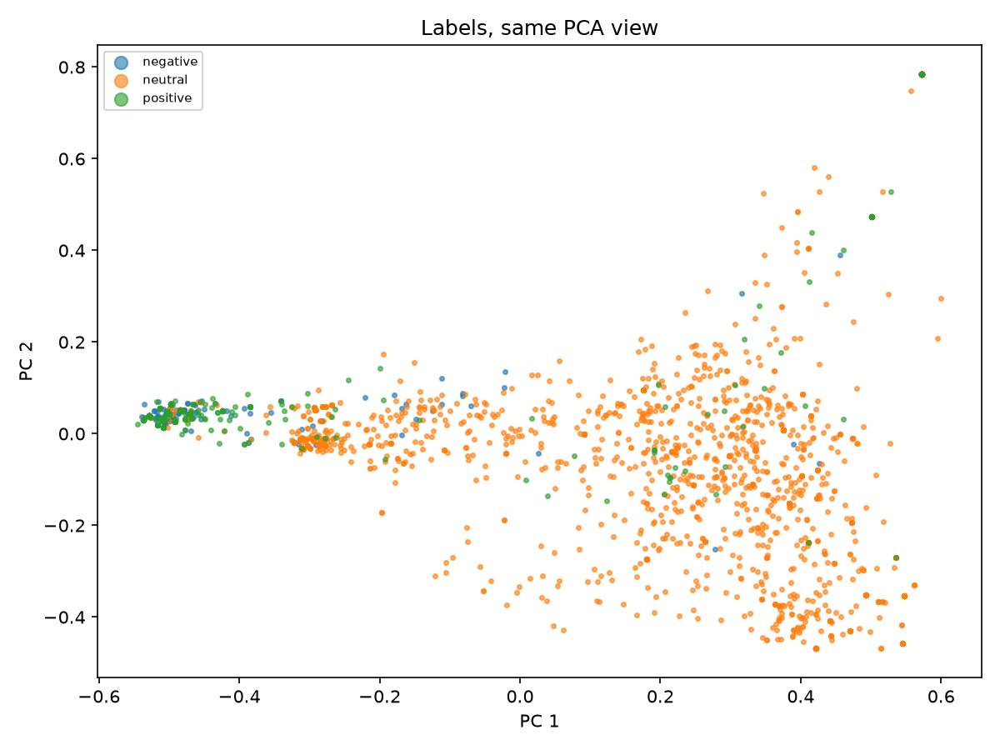

## Data

**Task:** classify PSX company announcements and Pakistani business news as positive,
negative or neutral for a current shareholder (rules in `docs/labelling_guidelines.md`).

### Collection
- **6,166 PSX company announcements** (Aug–Oct 2026, 530 companies). The PSX Data Portal
  requires a per-request token generated by its own JavaScript, so instead of bypassing it,
  pages were browsed normally in Chrome and the network log (HAR) was imported
  (`docs/data_collection.md`).
- **Business news** headlines from the Dawn business RSS feed.

### Cleaning and sampling
- Normalised text, parsed dates and symbols, removed 40 duplicates.
- Sampled **3,000 rows**, capping each company at 30 and each routine title at 40, so
  routine filings (board meeting notices, AGM notices) don't dominate.

### Text extraction
- Downloaded 2,816 announcement PDFs. About half were **scanned images**, so a Tesseract
  **OCR fallback** was added. 94% of rows ended up with full announcement text.
- An early labelling test showed only 1.6% negatives: the excerpt was cut off before the
  results tables. Extending the excerpt fixed it (13% negatives after relabelling).

### Labelling
- **Silver labels:** all rows pre-labelled with Claude (via Claude Code) against the guidelines.
- **Gold labels:** 300 random rows labelled blind by hand (291 kept after 9 skips).
- **LLM vs human agreement: 93.5% ± 2.8%, Cohen's κ = 0.85.** Errors concentrated in
  financial results and OCR text; LLM self-reported confidence was well calibrated
  (≥0.8 confidence: ~99% correct; ≤0.6: ~53%). Full report: `reports/label_quality.md`.

### Splits
| Split | Rows | Labels | neutral / positive / negative |
|---|---|---|---|
| train | 2,245 | LLM (silver) | 70% / 17% / 13% |
| val | 397 | LLM (silver) | 70% / 17% / 13% |
| test | 291 | human (gold), **frozen** | 73% / 14% / 13% |

- 58 training rows whose text duplicated a test item were removed to prevent leakage.
- The test set is fingerprinted (`data/splits/test_fingerprint.txt`); every model is
  evaluated on exactly the same items.
- Because 70% of rows are neutral, models are compared by **macro F1**, not accuracy.

## Phase 2: Unsupervised exploration

Each training announcement (2,245 rows; the test set was not used) was turned
into a 384-dimensional vector with `all-MiniLM-L6-v2`, grouped with K-means
(no labels used), and plotted in 2D with PCA. Groups were compared with the
LLM-assigned event types using ARI and NMI (0 = no match, 1 = perfect match).

| Input | k | Silhouette | ARI | NMI | PCA 2D variance |
|---|---|---|---|---|---|
| full text | 2 (best silhouette) | 0.121 | 0.048 | 0.083 | 14.8% |
| full text | 10 | 0.061 | 0.467 | 0.517 | 14.8% |
| **titles only** | 10 | **0.267** | **0.577** | **0.725** | **32.1%** |

**Findings**

- Picking k by silhouette alone chose k = 2, which split documents by format
  (letters vs report-style filings) and ignored the topic. With k = 10, the
  groups matched announcement types much better, even though silhouette was lower.
- Titles clustered better than full text on every metric, likely because the
  letterheads, addresses and greetings in the PDF text blur the topic.
- With titles and no labels, K-means found clean groups for financial results
  (quarterly vs annual), dividends, AGMs, board meetings, report filings and
  management changes. It also found a clear group of corporate briefing
  sessions, which the event-type list had no category for (all labelled `other`).
- Sentiment was **not** separated: almost all positive and negative items fall
  inside the two financial-results groups, in roughly equal numbers. Telling good
  from bad news needs a model that reads the figures in the full text. This
  motivates the supervised models in Phase 3 and removing boilerplate before training.

Reproduce: set `input` in `configs/embeddings.yaml` and `embeddings` in
`configs/clustering.yaml`, then run `uv run embed && uv run cluster`.
Full report: `reports/clustering.md`.

Plots below are from the titles-only, k = 10 run.

